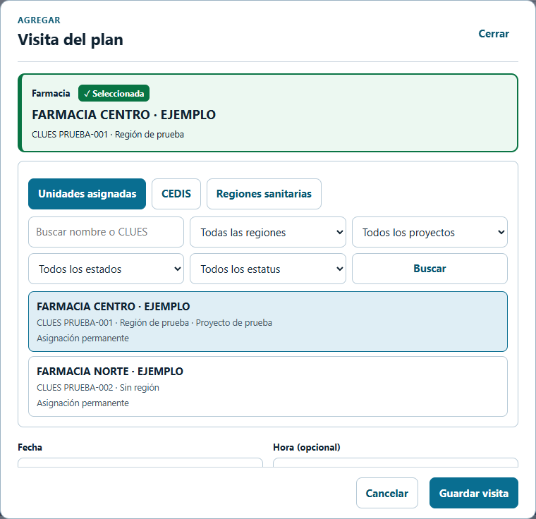
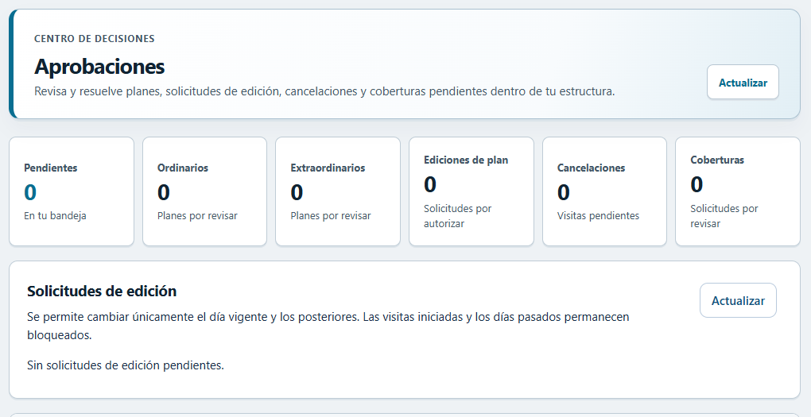
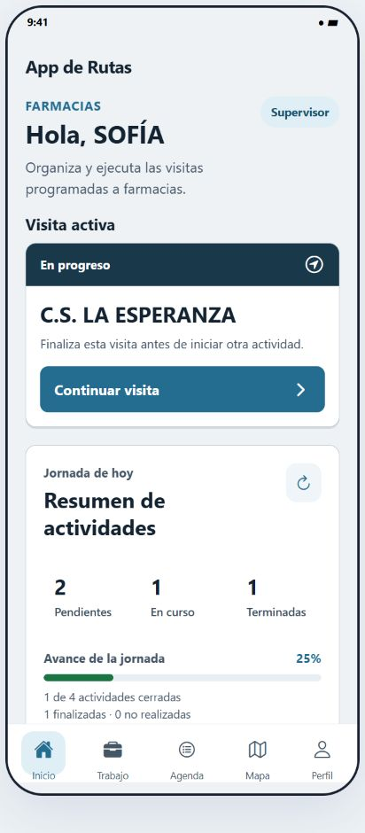
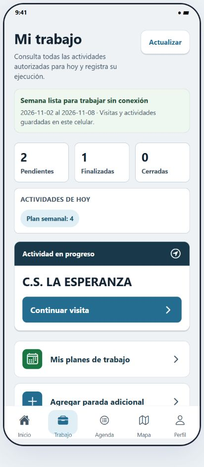
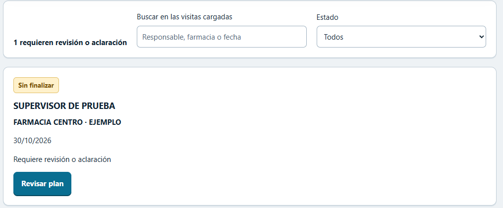
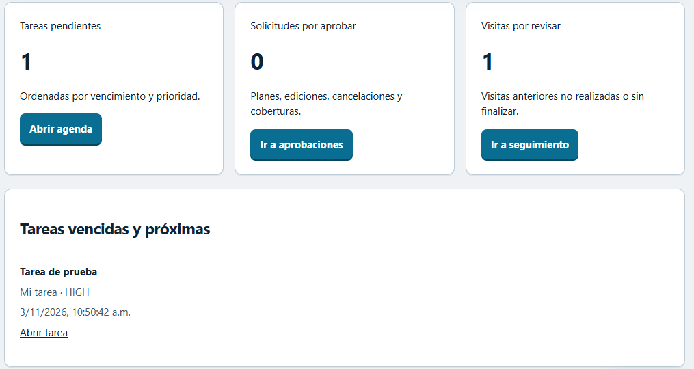
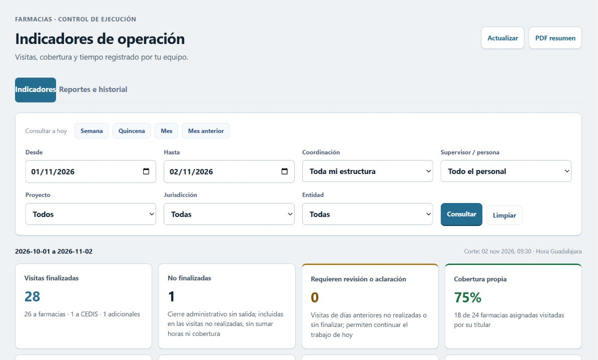
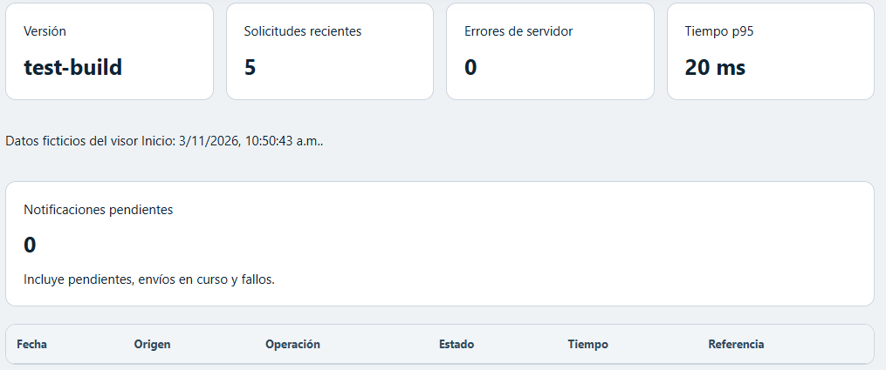
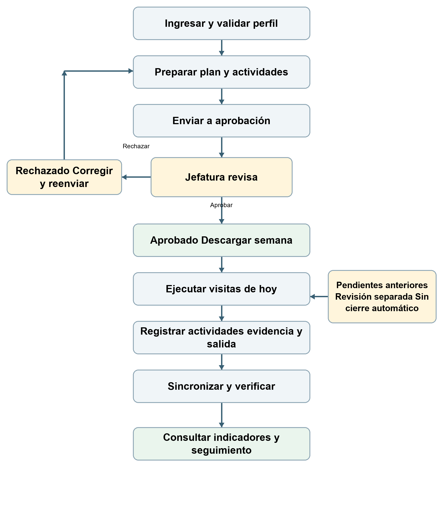
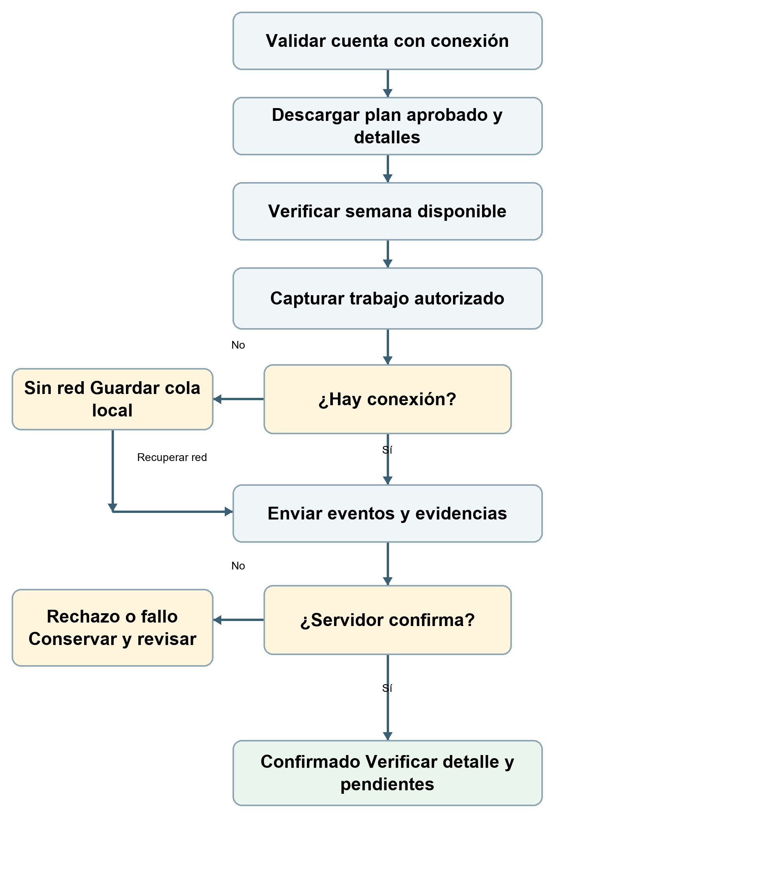

# APP DE RUTAS — Manual de operación

Edición ampliada · Noviembre de 2026

Guía de Farmacias para web y APK Android. Las funciones disponibles dependen del perfil y de publicar la versión correspondiente. Las capturas contienen datos de ejemplo.

El PDF ilustrado se distribuye en `public/manual/Manual-APP-DE-RUTAS.pdf`. La edición editable se conserva en `docs/manual/Manual-APP-DE-RUTAS.docx`.

## 1. Perfiles y navegación

La guía cubre el área de Farmacias en la web y en Android. Las opciones visibles dependen del perfil, sus asignaciones y la versión instalada. Un botón oculto no se resuelve cambiando de cuenta ni utilizando el acceso de otra persona.

| Perfil | Responsabilidad principal | Dónde trabajar |
| --- | --- | --- |
| Supervisor | Preparar sus planes, atender agenda y ejecutar visitas autorizadas. | Planes en web; Trabajo y Agenda en APK. |
| Coordinador | Revisar solicitudes de su estructura y atender el trabajo de campo que tenga habilitado. | Aprobaciones, Seguimiento y Agenda; funciones móviles según perfil. |
| Gerente | Revisar solicitudes y seguimiento de su alcance; consultar indicadores y reportes. | Web y opciones autorizadas de la APK. |
| Administrador | Administrar funciones expresamente habilitadas, como diagnóstico y actualizaciones. | Módulos administrativos de la web. |

### Encontrar una función

Web: utiliza el menú lateral. Planes organiza la planeación; Agenda contiene tareas; Aprobaciones contiene decisiones; Seguimiento de visitas contiene los pendientes de ejecución anterior.

APK: Inicio resume la jornada; Trabajo concentra las visitas; Agenda contiene tareas; Perfil reúne datos de cuenta, actualización y accesos auxiliares. En la edición actualizada se añaden Mis pendientes, Seguimiento y Manual desde Perfil.

Verifica tu nombre y rol al comenzar. Si esperabas otra función, confirma que usas la cuenta, el área y la versión correctas antes de reportar un permiso.

**Resultado esperado.** Cada usuario llega a los módulos de su responsabilidad sin utilizar cuentas compartidas.

## 2. Acceso y sesiones simultáneas

Puedes mantener abierta la misma cuenta en web y APK. La configuración consultada de Supabase permite sesiones simultáneas. Un token que caduca debe renovarse; su vencimiento no equivale, por sí solo, a cerrar la sesión.

### Procedimiento

1. Con internet, abre la web o la APK e ingresa con tu correo y contraseña. Comprueba el nombre, área y rol mostrados.

2. En el segundo dispositivo inicia sesión con la misma cuenta. Navega en ambos y actualiza una consulta para comprobar que ambos conservan acceso.

3. Al terminar en uno de los dispositivos utiliza Salir o Cerrar sesión. En la edición corregida, esa salida ordinaria se limita al dispositivo actual.

4. Para cambiar de cuenta, cierra la anterior y vuelve a validar la nueva. La información local de una cuenta no debe mostrarse a la siguiente.

5. Si cambias o recuperas la contraseña, contempla que se solicite acceso nuevamente por las medidas de seguridad del servicio.

### Si aparece token inválido

Anota hora, pantalla y acción que estabas realizando. Indica si tenías abierta la web y si acababas de salir o cambiar de cuenta.

Conserva los datos locales y comprueba conexión. Intenta validar nuevamente el acceso. No desinstales la APK ni borres su almacenamiento para resolver una sesión.

Después de publicar las correcciones, repite la prueba simultánea. Si persiste, entrega el mensaje y versión al soporte; que la configuración permita dos sesiones no sustituye esa comprobación.

**Espacio C01 — Acceso y perfil**

Inserta una captura de la pantalla de acceso o del perfil ya validado. Oculta correo y nombre reales. Deben verse el área y el rol de prueba.

**Resultado esperado.** Ambos dispositivos mantienen acceso; cerrar uno no debe expulsar al otro.

## 3. Crear un plan semanal o extraordinario

El plan define el periodo, las visitas y las actividades que la jefatura revisará. Preparar el borrador no autoriza su ejecución. Trabaja con conexión durante la creación y el envío.

### Procedimiento

1. En la web entra a Planes y pulsa Crear plan. Si tu perfil muestra una opción diferente, utiliza la habilitada para tu responsabilidad.

2. Elige Plan semanal o Plan extraordinario. En el semanal selecciona una fecha de la semana y revisa el intervalo de lunes a domingo que presenta el formulario.

3. Para un extraordinario selecciona Inicio y Fin. Confirma que el periodo corresponda al trabajo solicitado y que el término no sea anterior al inicio.

4. Pulsa Crear y abrir editor. Comprueba el tipo de plan, periodo y estado Borrador antes de agregar las visitas.

5. Si el sistema señala un plan ordinario activo para esa semana, revisa el existente. No generes otro para intentar evitar el aviso.

| Dato | Qué debes verificar |
| --- | --- |
| Tipo de plan | Semanal para la semana completa o extraordinario para el periodo seleccionado. |
| Periodo | Las fechas previstas de todas las visitas deben quedar dentro del intervalo. |
| Estado | Borrador mientras se prepara; pendiente de aprobación después del envío. |
| Revisión | Identifica la versión del plan que se está consultando. |

**Espacio C02 — Crear plan**

Inserta el formulario Nuevo plan con un periodo de ejemplo. Deben verse el selector de tipo, las fechas y Crear y abrir editor.

**Resultado esperado.** Se abre un borrador identificable por su tipo y periodo, listo para agregar visitas.

## 4. Seleccionar la farmacia correcta

La elección de unidad es una comprobación obligatoria antes de guardar. El nombre destacado sobre el catálogo representa la farmacia que se enviará con la visita.

### Procedimiento

1. En el editor pulsa Agregar visita. El modal debe mostrar el título completo y permitir llegar a Guardar visita sin quedar debajo del encabezado del sistema.

2. Selecciona Unidades asignadas, CEDIS o Regiones sanitarias, según el destino que corresponda. Utiliza nombre o CLUES y los filtros disponibles para acotar la búsqueda.

3. Pulsa la unidad del listado. Verifica arriba el recuadro Farmacia con la marca Seleccionada, el nombre y su CLUES o referencia. Si cambias la selección, ese resumen debe cambiar también.

4. Confirma la identidad de la unidad aunque existan nombres parecidos. CEDIS y regiones pueden usar una referencia interna en lugar de CLUES.

**Comprobación importante.** Si no aparece la unidad, revisa filtros, asignación y vigencia de cobertura. No selecciones una unidad distinta sólo para poder guardar.

**Resultado esperado.** El resumen y el elemento resaltado del catálogo corresponden a la misma unidad.

## 5. Fechas actividades y orden de la visita

Una visita útil para operación debe identificar qué se hará, dónde y en qué fecha. La hora es opcional cuando así lo permite el formulario; las actividades no deben quedar vacías.

### Procedimiento

1. En el modal confirma Fecha dentro del periodo del plan. Si estás editando un plan aprobado, respeta además las fechas que la autorización permita modificar.

2. Captura Hora si corresponde y revisa la condición Visita obligatoria. Evita horarios que no representen el trabajo acordado.

3. En Actividades planeadas pulsa + Actividad y describe una acción concreta. Utiliza Nota opcional para aclarar su alcance sin sustituir la descripción.

4. Ordena las actividades con las flechas y elimina sólo las que no correspondan al borrador. El formulario admite hasta 50 actividades y exige al menos una.

5. Pulsa Guardar visita y espera la respuesta. Revisa la tarjeta dentro del día correspondiente, su unidad y actividades antes de continuar.

### Orden de las visitas

Desde el día del plan utiliza las flechas de cada visita cuando estén habilitadas. Comprueba la secuencia completa después del cambio.

Cancelar o Cerrar descarta la edición no guardada del modal; no equivale a retirar una visita ya registrada. Una cobertura fuera de vigencia debe corregirse antes de guardar.

**Espacio C03 — Actividades planeadas**

Inserta la parte inferior del modal: Fecha, Hora, actividades, nota y Guardar visita. Usa una actividad de ejemplo sin datos operativos reales.

**Resultado esperado.** La visita aparece en la fecha correcta y conserva las actividades en el orden previsto.

## 6. Enviar el plan y entender sus estados

Antes de enviar, revisa el borrador completo. La decisión corresponde a la jefatura autorizada; no se debe iniciar una visita porque únicamente se haya enviado el plan.

### Procedimiento

1. Revisa periodo, unidades, fechas, orden y actividades. Corrige cualquier visita que no pertenezca al periodo o no describa el trabajo previsto.

2. Pulsa Enviar al coordinador y confirma la acción cuando el sistema lo solicite. Evita repetir el envío mientras la primera solicitud está en curso.

3. Espera la respuesta y abre el detalle. Confirma el estado Pendiente de aprobación y la revisión que se está consultando.

4. Si es rechazado, lee el comentario, corrige lo señalado y vuelve a enviarlo mediante el flujo disponible. Si es aprobado, prepara la descarga del celular.

| Estado | Significado y siguiente paso |
| --- | --- |
| Borrador | Se prepara el contenido. Aún no autoriza ejecución. |
| Pendiente de aprobación | La jefatura debe revisar. Consulta el estado sin duplicar el plan. |
| Aprobado | Puede descargarse y ejecutarse conforme a fechas y permisos. |
| Rechazado | Lee la observación, corrige y reenvía cuando corresponda. |
| Archivado | No es un plan activo de trabajo; sus registros históricos mantienen su significado. |

### Si el envío parece fallar

Antes de repetir, vuelve a consultar el plan. Una conexión interrumpida puede impedir ver la respuesta aunque el servidor haya recibido la solicitud.

Si el estado ya cambió, continúa desde ese estado. Si sigue en borrador y hay un error, conserva el mensaje para revisión.

**Resultado esperado.** La persona responsable y su jefatura reconocen el mismo estado y revisión del plan.

## 7. Revisar aprobar o rechazar

Aprobaciones reúne decisiones pendientes. El acceso a una solicitud depende de la jerarquía y alcance del usuario; la visibilidad en una captura de ejemplo no amplía los permisos reales.

### Procedimiento

1. Abre Aprobaciones y pulsa Actualizar. Identifica el tipo de solicitud: plan ordinario, extraordinario, edición, cancelación o cobertura, según las opciones disponibles.

2. Abre el detalle y revisa responsable, periodo, visitas, actividades y observaciones. No decidas únicamente a partir del total de la bandeja.

3. Aprueba cuando el contenido corresponda al trabajo autorizado. Si rechazas, escribe una observación que indique qué debe corregirse.

4. Espera la confirmación y actualiza la bandeja. Comprueba que la decisión se refleje en el detalle y que la solicitud no permanezca indebidamente pendiente.

**Comprobación importante.** En Puebla, los coordinadores comparten sólo los supervisores configurados. Los planes propios de un coordinador corresponden a la gerencia autorizada. No cambies asignaciones para hacer aparecer una solicitud.

**Resultado esperado.** La decisión queda registrada en el plan o solicitud correspondiente; Seguimiento de visitas se consulta por separado.

## 8. Cambiar un plan aprobado y atender cancelaciones

Las correcciones posteriores a la aprobación tienen un proceso propio. Solicitar edición no concede de inmediato permiso para modificar, y editar no debe alterar el cumplimiento ya registrado.

### Procedimiento

1. En Mis planes identifica el plan y utiliza Solicitar edición cuando esté disponible. Explica el ajuste que necesitas y envíalo por el flujo habilitado.

2. Espera la decisión. Con autorización vigente abre el editor y revisa las fechas y visitas que pueden modificarse.

3. Realiza el cambio, guarda y vuelve a consultar el detalle. Conserva la relación entre periodo, revisión y autorización.

4. Para una cancelación utiliza la acción específica y registra el motivo solicitado. No sustituyas una cancelación por archivar o borrar información.

| Situación | Qué debes hacer |
| --- | --- |
| Fecha pasada o visita ejecutada | Conservar los hechos y solicitar revisión; no simular otra fecha o cumplimiento. |
| Edición pendiente o rechazada | Consultar la observación y esperar o corregir la solicitud. |
| Visita con cancelación pendiente | Atender la decisión antes de intentar acciones incompatibles. |
| Cobertura temporal vencida | Revisar la fecha y el alcance; no forzar la selección de unidad. |
| Cierre administrativo | Interpretarlo conforme a su motivo; no equivale a una salida real de campo. |

### Comprobación posterior

Confirma que el responsable y la jefatura consulten el mismo contenido actualizado. Después, con internet, actualiza Trabajo en el celular.

Si hay trabajo local sin sincronizar, conserva los pendientes y revisa el mensaje del sistema antes de reemplazar información descargada.

**Resultado esperado.** El cambio respeta su autorización y conserva el historial de ejecución y decisiones.

## 9. Inicio y Trabajo en el celular

Inicio orienta la jornada; Trabajo permite consultar y continuar las visitas. El diseño prioriza una visita activa para evitar que se pierda entre tarjetas y accesos secundarios.

### Procedimiento

1. Verifica la cuenta y abre Inicio. Consulta el resumen, la visita activa y los accesos que correspondan a tu perfil.

2. En Trabajo confirma el día, el plan y las visitas. Cuando tengas conexión, utiliza Actualizar para consultar el estado vigente.

3. Si existe una visita de hoy en curso, utiliza Continuar visita. Debe abrir el detalle de esa misma unidad, con lo ya capturado.

4. Al volver a Inicio o cambiar de pestaña no se debe perder la visita ni reiniciar sus datos.

**Resultado esperado.** Puedes identificar qué atender hoy y volver al detalle real sin crear otra visita.

## 10. Registrar la entrada de una visita

La entrada debe representar el inicio real de trabajo en una unidad. Requiere que el plan, la programación, el perfil y las condiciones de ubicación permitan la operación.

### Procedimiento

1. Abre Trabajo y elige una visita aprobada programada para hoy. Comprueba el nombre y la referencia de la unidad antes de registrar.

2. Permite el uso de ubicación cuando se solicite. Espera una lectura disponible; si la precisión o ubicación no es válida, atiende el aviso mostrado.

3. Revisa las actividades y pulsa la acción de entrada disponible. Espera la confirmación y verifica el estado En curso.

4. Si trabajas sin red, confirma que la acción quedó guardada localmente y después revisa su sincronización. No confundas guardado local con confirmación del servidor.

5. Regresa a Inicio o Trabajo y comprueba que Continuar visita te lleva a ese registro.

### Permisos y ubicación

Si la ubicación está desactivada o el permiso fue rechazado, revísalo en los ajustes del teléfono y vuelve a intentar.

Si el sistema rechaza la ubicación o indica otra visita activa del mismo día, no registres una ubicación ficticia ni abras otra cuenta para evitar el control.

**Espacio C04 — Entrada y estado En curso**

Inserta una captura de la visita de prueba con nombre de unidad, acción de entrada y estado posterior. Oculta coordenadas precisas y datos personales.

**Resultado esperado.** La visita correcta queda En curso y su entrada corresponde al trabajo realizado.

## 11. Resolver actividades y adjuntar evidencia

La evidencia respalda la actividad o visita a la que se adjunta. Una fotografía guardada en el teléfono no debe considerarse enviada hasta comprobar el estado correspondiente.

### Procedimiento

1. Dentro de la visita abre la actividad y lee su descripción y nota. Confirma que estás en la unidad correcta antes de tomar una foto.

2. Utiliza la cámara o la opción de evidencia habilitada. Permite el acceso necesario y verifica la imagen antes de guardarla.

3. Registra la realización o la omisión permitida y su motivo. Completa las condiciones que solicite la aplicación; no sustituyas evidencia requerida por una nota genérica.

4. Revisa que la imagen y el comentario permanezcan asociados al registro correcto al salir y volver a entrar al detalle.

5. Con red, comprueba el envío. Sin red, conserva la evidencia y su pendiente para sincronizar después.

### Calidad de la captura

Procura que la imagen sea legible y pertinente al trabajo. Evita incluir contraseñas, documentos ajenos al procedimiento o personas que no sea necesario fotografiar.

Si una carga se interrumpe, revisa su estado antes de adjuntar otra vez la misma fotografía. Un reintento de sincronización no exige volver a crear la actividad.

**Espacio C05 — Actividad y evidencia**

Inserta una captura del detalle de una actividad de prueba con su evidencia y estado. No utilices fotos ni nombres de personas reales.

**Resultado esperado.** Cada actividad conserva su estado, motivo cuando procede y evidencia correspondiente.

## 12. Registrar salida y continuar la jornada

La salida cierra una visita real. El sistema distingue una visita terminada de una visita anterior pendiente o de un cierre administrativo. Esa diferencia debe conservarse en la operación y los reportes.

### Procedimiento

1. Antes de salir verifica que todas las actividades estén resueltas y que la evidencia requerida esté guardada.

2. Utiliza la acción de salida de la visita. Si aparece un bloqueo, lee qué actividad, evidencia o condición falta y atiéndela.

3. Espera la confirmación, vuelve al detalle y revisa el estado. Con internet, confirma también la sincronización.

4. Una vez cerrada la visita de hoy, continúa con la siguiente visita autorizada del día.

| Caso | Comportamiento esperado |
| --- | --- |
| Otra visita abierta de hoy | Impide iniciar una segunda visita simultánea del mismo día. |
| Visita anterior sin finalizar | No bloquea el trabajo de hoy; mantiene entrada y evidencias para revisión. |
| Visita anterior no realizada | No se convierte automáticamente en realizada ni se reprograma sola. |
| Actividades o evidencia faltantes | Debe atenderse el bloqueo que indique la aplicación antes de la salida. |
| Cierre administrativo sin salida | No representa una salida real ni debe sumar cumplimiento u horas completadas. |

### Al finalizar la jornada

Revisa si quedó una visita abierta involuntariamente y consulta Mis pendientes. Comunica a la jefatura los registros que necesiten revisión, sin fabricar horas ni cierres.

Si la salida quedó guardada localmente, recupera conexión y verifica que haya llegado al servidor antes de dar por terminada la sincronización.

**Resultado esperado.** El registro y su estado describen lo que efectivamente ocurrió en la visita.

## 13. Preparar la semana para trabajar sin conexión

El trabajo sin internet depende de haber validado la cuenta y descargado información antes de salir. La aplicación no puede mostrar un plan que nunca estuvo guardado en ese dispositivo.

### Procedimiento

1. Con internet, confirma que el plan de la semana esté aprobado y utiliza Actualizar en Trabajo.

2. Espera el resultado y revisa el indicador de semana disponible. Comprueba sus fechas y que correspondan a la jornada que realizarás.

3. Abre las visitas y los detalles de plan que necesitarás. Confirma que las actividades estén presentes, no sólo el nombre del plan.

4. Haz una comprobación controlada: desconecta la red y vuelve a consultar la información descargada. Al recuperar conexión revisa que el estado siga siendo correcto.

5. Antes de salir consulta Mis pendientes para identificar fotos, eventos o tareas que aún no se hayan sincronizado.

| Disponible sin red si ya se descargó | Requiere conexión o servicio externo |
| --- | --- |
| Consulta del plan, visitas y actividades guardadas. | Descarga de información nueva o de un plan no guardado. |
| Captura de ejecución y evidencia habilitada por el flujo local. | Envío y decisiones de solicitudes que exigen validación en línea. |
| Consulta de datos locales de la cuenta autorizada. | Mapas y servicios externos cuando no tengan información disponible. |

**Espacio C06 — Semana descargada**

Inserta Trabajo mostrando el indicador de semana guardada y su periodo. Después valida la misma semana sin conexión.

**Resultado esperado.** Antes de salir puedes comprobar qué información está disponible y qué queda pendiente de descargar.

## 14. Sincronizar pendientes y verificar el envío

La captura local y la confirmación del servidor son momentos distintos. La sincronización puede necesitar varios pasos para eventos y evidencias; conservar el original evita pérdidas y duplicaciones.

### Procedimiento

1. Recupera una conexión estable y abre Trabajo. Pulsa Actualizar y deja terminar la operación.

2. Desde Perfil abre Mis pendientes y revisa las cantidades de visitas, evidencias y agenda. Observa también los fallos y la antigüedad del pendiente más antiguo.

3. Abre una visita de prueba y confirma que sus actividades y fotos estén presentes. Después consulta el mismo registro en la web cuando corresponda.

4. Actualiza nuevamente para comprobar que el registro no se duplicó. Si continúa un fallo, conserva el mensaje y solicita revisión sin borrar la cola.

| Lo que ves | Cómo interpretarlo |
| --- | --- |
| Por sincronizar | Hay datos locales que todavía no tienen confirmación completa de envío. |
| Requiere atención o fallo | Una operación necesita revisión; no debe descartarse para ocultar el aviso. |
| Última descarga | Indica cuándo se actualizó información; no demuestra por sí sola que se enviaron todas las fotos. |
| Sin conexión | Trabaja con la información local habilitada y recupera red para actualizar. |

### Segundo plano

Android decide cuándo puede ejecutar trabajo en segundo plano según conectividad, batería y restricciones. No se debe prometer una hora exacta de sincronización.

No cierres sesión para intentar acelerar el envío. Después de Forzar detención, vuelve a abrir la APK. Revisa al final los pendientes de la cuenta correcta.

**Resultado esperado.** La disminución de pendientes coincide con la consulta del mismo trabajo en el servidor; no se pierden ni duplican operaciones.

## 15. Organizar tareas de agenda

Agenda permite atender compromisos y dar seguimiento a tareas. Una tarea no reemplaza una visita ni genera por sí misma entrada, salida o cobertura de una farmacia.

### Procedimiento

1. Abre Agenda y elige Mis tareas. Si tu rol permite asignar, utiliza la vista de estructura y el responsable correspondiente.

2. Consulta estado, prioridad y vencimiento. Abre el detalle para revisar la descripción antes de comenzar.

3. Para crear una tarea utiliza Nueva tarea y completa los campos disponibles. Si asignas a otra persona, verifica que sea el responsable correcto dentro de tu alcance.

4. Actualiza el estado de acuerdo con el trabajo realizado y utiliza comentarios para dejar seguimiento. Adjunta evidencia cuando la tarea la requiera.

5. Después de guardar vuelve al listado y al detalle para comprobar el cambio. Revisa la sincronización si se capturó desde la APK sin red.

| Estado | Interpretación |
| --- | --- |
| Pendiente | La tarea está por atender. |
| En curso | Se está trabajando en ella. |
| Terminada | Se completó conforme a las condiciones que solicita el sistema. |
| Cancelada | Fue cancelada por el flujo permitido; no equivale a trabajo realizado. |

**Espacio C07 — Detalle de tarea**

Inserta una tarea de ejemplo con prioridad, vencimiento, estado y comentario. No incluyas datos de responsables reales.

**Resultado esperado.** La persona responsable y su jefatura pueden reconocer el estado y los avances de la misma tarea.

## 16. Solicitar vacaciones con calendario de rango

La solicitud debe indicar el primer y último día de ausencia y un motivo o comentario. Enviar una solicitud no significa que el periodo ya esté aprobado.

### Procedimiento

1. Abre el apartado Vacaciones y despliega el formulario. Realiza el envío con conexión.

2. Abre el calendario de rango y selecciona el inicio. Después selecciona el término. Para un solo día, elige ese día como inicio y final del rango.

3. Si el rango cruza de mes, navega al mes correspondiente y revisa el resumen completo. No deduzcas las fechas sólo por el color de las celdas.

4. Confirma el rango para aplicarlo al formulario. Cancelar debe conservar las fechas que estaban confirmadas antes de abrir el calendario.

5. Escribe Motivo o comentario, revisa las fechas y envía una sola vez. Consulta después si aparece pendiente, aprobada o rechazada.

6. La jefatura autorizada revisa la solicitud y registra su decisión. Si es rechazada, consulta la observación antes de reenviar.

**Espacio C08 — Calendario y resumen de vacaciones**

Inserta el calendario con un rango de ejemplo y el formulario mostrando Inicio, Término y Motivo o comentario.

**Comprobación importante.** No planifiques el trabajo como si las vacaciones ya estuvieran autorizadas mientras la solicitud siga pendiente.

**Resultado esperado.** El resumen, la solicitud guardada y la decisión corresponden exactamente al rango elegido.

## 17. Asignaciones y coberturas temporales

La unidad que puede consultar o programar cada persona depende de su asignación y alcance. Una cobertura temporal tiene una vigencia que debe coincidir con la fecha de la visita.

### Procedimiento

1. Antes de programar revisa las unidades disponibles en el catálogo y distingue la asignación permanente de la cobertura temporal cuando se muestre.

2. Para una cobertura revisa responsable, unidad o alcance y fechas. Envía la solicitud o acción disponible sólo si tu rol lo permite.

3. Espera la autorización correspondiente cuando aplique. Después actualiza el catálogo y comprueba que la fecha de la visita quede dentro de la vigencia.

4. Si la unidad no aparece o indica acceso no permitido, revisa filtros y fechas. Solicita revisión de la asignación; no utilices otra unidad para sustituirla.

| Comprobación | Por qué importa |
| --- | --- |
| Titular y persona cubierta | Evita asignar trabajo a un responsable equivocado. |
| Unidad y alcance | La autorización no se extiende automáticamente a otras farmacias o estados. |
| Inicio y término | Una visita fuera del rango no queda autorizada por esa cobertura. |
| Estado de solicitud | Una solicitud pendiente no equivale a cobertura aprobada. |

### Para la jefatura

Comprueba que la decisión corresponda a tu estructura. Si se requiere corregir una asignación, utiliza su módulo autorizado y conserva la trazabilidad.

Una cobertura o asignación no debe utilizarse para alterar retroactivamente el registro de una visita ya realizada.

**Resultado esperado.** La programación utiliza únicamente las unidades y fechas autorizadas para la persona responsable.

## 18. Atender el seguimiento de visitas anteriores

Seguimiento de visitas es una vista independiente de Aprobaciones. Permite localizar trabajo anterior no realizado o sin finalizar sin impedir la ejecución válida de hoy.

### Procedimiento

1. Con un perfil autorizado abre Seguimiento de visitas. En web utiliza el menú lateral; en la APK actualizada, el acceso de Perfil.

2. Pulsa Actualizar y revisa responsable, unidad, fecha y motivo: No realizada o Sin finalizar.

3. En web busca entre los registros cargados o filtra por estado. Si hay más registros, utiliza Cargar más visitas; el total puede ser mayor que la lista visible.

4. Pulsa Revisar plan para consultar el registro original y acordar la revisión con la persona responsable.

**Comprobación importante.** Abrir el plan no crea una aclaración ni cierra la visita. La alerta conserva entradas, evidencias y estados; no inventa salidas ni cumplimiento.

**Resultado esperado.** La jefatura identifica el pendiente y llega al detalle correcto sin mezclarlo con solicitudes por aprobar.

## 19. Usar la bandeja de pendientes

Mis pendientes concentra accesos y cantidades para orientar la atención diaria. La web consulta el servidor; el celular también puede mostrar operaciones que todavía existen sólo en su almacenamiento local.

### Procedimiento

1. En web abre Mis pendientes y actualiza. Revisa tareas y, cuando tu perfil lo permita, solicitudes por aprobar y visitas por revisar.

2. Utiliza Abrir agenda, Ir a aprobaciones o Ir a seguimiento para actuar en el módulo correspondiente. La tarjeta no sustituye la revisión del detalle.

3. En la APK entra por Perfil a Mis pendientes y diagnóstico. Revisa visitas, evidencias y agenda por sincronizar, fallos y antigüedad.

4. Si un apartado muestra error, vuelve a consultar con conexión; no interpretes el guion o el error como cero pendientes.

### Diferencia entre web y celular

Un evento local pendiente puede no aparecer todavía en la web. Verifica la sincronización antes de comparar cantidades.

La bandeja conserva los avisos y recordatorios existentes. No incorpora por sí sola nuevos escalamientos automáticos ni una resolución formal de aclaraciones.

**Resultado esperado.** Sabes qué requiere acción y en qué módulo debe atenderse, sin confundir lo local con lo confirmado por el servidor.

## 20. Consultar indicadores y reportes

Los resultados dependen del periodo y del alcance seleccionado. Antes de interpretar una cifra, verifica qué responsable, unidad o grupo estás consultando.

### Procedimiento

1. En web abre Indicadores o Reportes, según la consulta que necesites.

2. Selecciona el periodo y los filtros disponibles para tu perfil. Aplica o actualiza la consulta y revisa el intervalo mostrado.

3. Consulta el detalle de los registros que explican una cifra. Distingue visitas completadas, visitas anteriores por revisar y cierres administrativos.

4. Si exportas, conserva junto al archivo el periodo y filtros utilizados para que otra persona pueda interpretar el resultado.

**Comprobación importante.** Una visita no realizada o sin finalizar no debe sumar cumplimiento, cobertura ni horas completadas. Un cierre administrativo sin salida mantiene su significado de visita no finalizada.

**Resultado esperado.** La cifra y los registros que la explican corresponden al mismo periodo y alcance.

## 21. Consultar el diagnóstico administrativo

El módulo de diagnóstico ayuda a identificar fallos y demoras recientes. Su acceso está reservado a administración. La cantidad de eventos es limitada y se reinicia al desplegar la instancia.

### Procedimiento

1. Abre Diagnóstico y pulsa Actualizar. Revisa versión, cantidad de solicitudes, errores del servidor y tiempo p95.

2. Si se reportó una falla, relaciona la hora y referencia de solicitud con los eventos disponibles. Evita deducir una causa sólo por un conteo aislado.

3. Consulta la cola de notificaciones para distinguir envíos pendientes, en curso y fallidos cuando la información esté disponible.

4. Si el fallo pertenece a un celular, pide también su versión, conexión y estado de colas locales; no todos los problemas del dispositivo llegan al servidor.

### Alcance de esta herramienta

El p95 resume un tiempo de respuesta del conjunto reciente; no describe la duración del trabajo de una visita.

La captura básica de errores de pantalla no detecta todos los cierres nativos de Android. La vista tampoco sustituye un historial permanente de monitoreo externo.

**Resultado esperado.** El reporte de la incidencia identifica versión, momento y referencia sin exponer credenciales ni datos de las operaciones.

## 22. Actualizar la APK y distinguir una preview

Una compilación de pruebas y una actualización estable son entregas distintas. El usuario de campo debe instalar únicamente la versión que el responsable haya autorizado para su uso.

### Procedimiento

1. Antes de actualizar revisa Mis pendientes y conserva la información local. Comprueba que el archivo o aviso corresponda a APP DE RUTAS y a la versión indicada.

2. Si la APK muestra una actualización aprobada, lee la versión y sus notas y utiliza la acción disponible para descargarla.

3. Atiende el permiso de instalación de Android cuando corresponda. Si lo rechazas o cancelas el instalador, consulta el estado y vuelve a intentar desde la aplicación.

4. Al abrir la aplicación actualizada valida la cuenta y verifica que planes, actividades y pendientes sigan presentes.

5. Prueba las funciones indicadas para esa versión: consulta offline, reconexión, teclado, cámara, ubicación y sesiones web y móvil simultáneas.

### Para administración

Una preview terminada en Expo no se convierte automáticamente en la versión estable. Primero debe probarse el artefacto exacto y seguirse el proceso de aprobación.

Si una versión presenta problemas, utiliza el procedimiento de retiro y corrección compatible. No pidas desinstalar ni forzar un descenso de versión para resolver datos pendientes.

**Espacio C09 — Aviso de actualización**

Inserta el aviso con versión y notas de una actualización de prueba autorizada. No incluyas enlaces privados ni credenciales.

**Resultado esperado.** La versión instalada es la autorizada y conserva la información operativa del dispositivo.

## 23. Resolver incidencias sin perder información

Antes de repetir una acción o eliminar datos, identifica qué ocurrió y conserva el registro original. Los siguientes pasos orientan la revisión, pero no sustituyen la autorización que exija el sistema.

| Síntoma | Primera comprobación | Siguiente acción |
| --- | --- | --- |
| No aparece el plan | Cuenta, periodo y aprobación. | Con internet actualiza Trabajo y abre el detalle. |
| No aparece una farmacia | Filtros, asignación y vigencia. | Solicita revisión del alcance si continúa ausente. |
| Otra visita está activa | Fecha de la visita abierta. | Cierra la activa de hoy cuando corresponda; las anteriores se revisan aparte. |
| No permite la salida | Actividades y evidencia requeridas. | Resuelve el bloqueo mostrado y vuelve a consultar. |
| Foto pendiente | Conexión y estado de la cola. | Conserva el original y verifica el envío antes de duplicar la captura. |
| Token inválido o sesión perdida | Versión, conexión y uso del otro dispositivo. | Registra el mensaje y valida acceso; no borres almacenamiento. |
| Web y APK no coinciden | Mismo registro, cuenta y última sincronización. | Actualiza ambos y revisa los pendientes locales. |
| Un botón queda oculto | Teclado, desplazamiento y tamaño de pantalla. | Desplaza el formulario; informa pantalla y tamaño de letra si persiste. |

### Qué entregar a soporte

Versión de la APK, modelo del teléfono, pantalla, hora aproximada y si había internet. Describe qué esperabas y qué sucedió, con pasos para repetirlo.

Incluye la referencia de solicitud si está disponible y una captura sin datos sensibles. Nunca envíes contraseña, token ni una copia de la base local por un canal no autorizado.

**Resultado esperado.** La incidencia puede investigarse sin perder la cola ni recrear operaciones innecesariamente.

## 24. Flujo general de planeación y ejecución

El proceso conecta decisiones de jefatura con ejecución de campo. Rechazar devuelve el plan a corrección; aprobar permite preparar la descarga y ejecutar dentro de las condiciones autorizadas.

**Resultado esperado.** El seguimiento de visitas anteriores permanece separado del trabajo de hoy y de las decisiones por aprobar.

## 25. Flujo del trabajo sin conexión

La información guardada en el celular debe conservar su cuenta, su identidad y su estado hasta que el servidor confirme la operación. Un fallo definitivo requiere revisión y no debe ocultarse eliminando el pendiente.

**Resultado esperado.** Guardado local, envío y confirmación se distinguen durante todo el proceso.

## 26. Lista de comprobación para una jornada

Utiliza esta lista durante la capacitación y después de instalar una versión nueva. Registra el resultado de cada comprobación con una cuenta y un plan de prueba autorizados.

### Registro de aceptación

Fecha y versión revisada: __________________________________________

Responsable de la prueba: _________________________________________

Incidencias por resolver: __________________________________________

Resultado y autorización de uso: __________________________________

- [ ] La cuenta y el perfil son correctos en web y APK.
- [ ] El plan tiene el periodo y la aprobación esperados.
- [ ] La selección de farmacia muestra el nombre y referencia correctos.
- [ ] El modal permite llegar a Guardar sin recortes ni botones ocultos.
- [ ] Trabajo muestra las visitas y actividades descargadas de la semana.
- [ ] La visita activa se puede continuar desde Inicio y Trabajo.
- [ ] La entrada, actividades, evidencias y salida pertenecen a la misma visita.
- [ ] Una visita anterior pendiente no bloquea la ejecución válida de hoy.
- [ ] Dos visitas del mismo día no se abren simultáneamente.
- [ ] La consulta sin red funciona con información previamente descargada.
- [ ] Al recuperar conexión llegan eventos y fotos sin duplicaciones.
- [ ] Vacaciones conserva exactamente el rango confirmado y el comentario.
- [ ] Seguimiento aparece fuera de Aprobaciones.
- [ ] Mis pendientes distingue errores de ausencia de trabajo pendiente.
- [ ] Ambos dispositivos siguen activos al navegar y renovar el acceso.
- [ ] Salir de un dispositivo conserva el acceso del otro.
- [ ] La actualización de APK conserva la información local.
## 27. Completar y mantener las capturas del manual

El archivo Word permite sustituir las imágenes de referencia e insertar capturas en los espacios identificados. Usa datos de prueba y conserva el tamaño y proporción para que sigan siendo legibles.

### Procedimiento

1. Localiza el espacio C01 a C09 en el capítulo correspondiente. Lee qué debe verse antes de obtener la captura.

2. En Word selecciona el texto dentro del espacio, elimínalo e inserta la imagen. Ajusta su ancho al espacio disponible y conserva la proporción.

3. Actualiza el pie de figura si cambias el contenido. No reutilices una captura de otra versión si muestra una acción diferente.

4. Después de insertar las imágenes, guarda el Word y exporta de nuevo a PDF. Comprueba cortes de página, tamaño del texto y que no falten los botones importantes.

| Espacio | Captura requerida |
| --- | --- |
| C01 | Acceso o perfil validado de prueba. |
| C02 | Nuevo plan con tipo y periodo. |
| C03 | Fecha, hora y actividades del modal. |
| C04 | Entrada y estado En curso de una visita. |
| C05 | Actividad y evidencia de prueba. |
| C06 | Semana guardada y su periodo. |
| C07 | Tarea con estado, prioridad y vencimiento. |
| C08 | Calendario de rango y resumen de vacaciones. |
| C09 | Aviso de actualización con versión y notas. |

**Comprobación importante.** Las capturas incluidas muestran datos de ejemplo. Antes de distribuir una edición final, comprueba que correspondan a la versión que utiliza el personal y que no expongan nombres, correos, ubicaciones o evidencias reales.

## 28. Glosario y consulta rápida

Los términos ayudan a distinguir planeación, ejecución y sincronización. Cuando una pantalla muestre un estado específico, utiliza su significado operativo y consulta el detalle antes de actuar.

| Término | Significado en la operación |
| --- | --- |
| Plan | Conjunto de visitas y actividades de un periodo. |
| Visita | Registro de trabajo programado en una unidad o destino permitido. |
| Actividad | Acción que debe resolverse dentro de una visita. |
| CLUES o referencia | Dato para identificar la unidad, además de su nombre. |
| Aprobación | Decisión que autoriza una solicitud dentro del alcance de la jefatura. |
| Revisión del plan | Versión de su contenido; no equivale a cumplimiento. |
| Evidencia | Archivo o registro que respalda el trabajo capturado. |
| Cola local | Operaciones conservadas en el teléfono antes de completar su envío. |
| Sincronización | Intercambio y confirmación de información entre celular y servidor. |
| Cobertura temporal | Permiso de alcance y vigencia definidos para la operación. |
| Token | Credencial temporal de acceso que la aplicación debe renovar. No se comparte. |
| Cierre administrativo | Registro administrativo distinto de una salida real de campo. |

### Rutina recomendada

Antes de salir: valida cuenta, aprobación, semana descargada y pendientes.

Durante la visita: comprueba unidad, registra hechos y conserva evidencia.

Al terminar: revisa salidas, sincronización y pendientes que deban aclararse.
